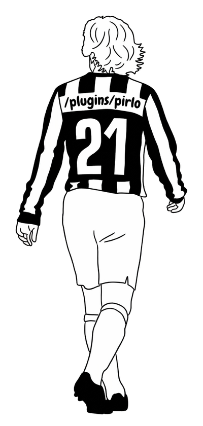
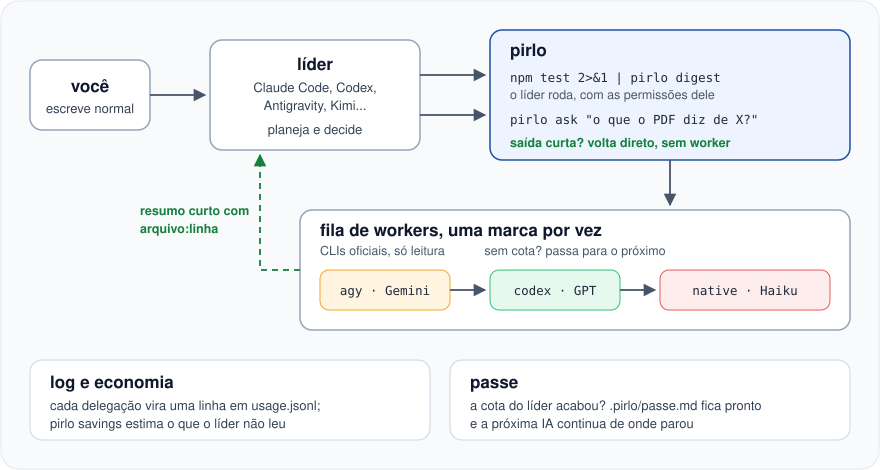

<p align="center">
  
</p>

# pirlo

Seu agente de código gasta a maior parte da cota **lendo**: 30 mil tokens de log de teste para achar duas falhas, vinte arquivos abertos para descobrir onde um token é validado. O pirlo faz o agente que você usa (o **líder**) passar esse trabalho braçal para **workers mais baratos**, sozinho, e receber só um resumo com `arquivo:linha`. Quando uma IA fica sem cota, ele troca de marca sozinho.

O nome é uma homenagem ao Andrea Pirlo, o regista que recebia a bola, decidia e distribuía.

## Instalação

Linux, WSL ou macOS, com Python 3.9 ou mais novo. Na pasta do projeto:

```bash
curl -fsSL https://raw.githubusercontent.com/isaiasaltoe/pirlo/main/install.sh | sh
```

O setup abre no terminal, em português ou inglês, explica cada pergunta e pergunta:

- em quais IAs usar o pirlo como líder. Ele detecta as que você tem: Claude Code, Codex, Antigravity, Gemini CLI, Kimi, Copilot CLI, opencode, Cursor CLI e outras;
- se o pirlo fica ativo em todos os repositórios ou só neste;
- a ordem dos workers, uma IA de cada marca;
- se pode liberar os comandos de leitura do pirlo no Claude Code e gravar a regra que deixa o pirlo sair do sandbox do Codex.

No fim, ele instala o plugin em cada IA escolhida. Para mudar alguma resposta, rode `pirlo setup` de novo.

## Como funciona

<p align="center">
  
</p>

Você não chama nada: escreve normalmente. Pedidos como estes vão para um worker mais barato, e você recebe só o resumo:

- "roda os testes e me diz o que quebrou"
- "o CI quebrou, o que foi?"
- "o que mudou nessa branch?"
- "onde a gente valida o token do usuário?"

Planejamento, decisões e edições pequenas continuam com o líder.

## Quando a cota acaba

**Worker sem cota.** O pirlo passa o trabalho para a próxima IA da fila sozinho, sem você perceber.

**Líder sem cota.** O pirlo deixa tudo pronto para outra IA continuar: abra outra IA na mesma pasta e diga "continua". No Claude Code isso é automático; nas outras IAs, rode `pirlo passe` antes.

## Comandos

| Comando | O que faz |
| --- | --- |
| `pirlo setup` | configura idioma, IAs, escopo e workers |
| `pirlo show` | mostra a fila de workers, as cotas e quem está descansando |
| `pirlo savings` | estima quanto o líder deixou de ler; no Claude Code, `/pirlo:savings` |
| `pirlo passe` | deixa o trabalho pronto para outra IA continuar |
| `pirlo detect` | lista as IAs instaladas, o login e os modelos, sem gastar cota |

A economia é uma **estimativa**, porque não dá para saber quanto o líder teria lido sem o pirlo.

## Configuração

O setup escreve `~/.config/pirlo/config.json` (global) ou `.pirlo/config.json` (só no projeto, fora do git):

```json
{
  "workers": [
    { "cli": "agy", "model": "gemini-3.8-flash-medium" },
    { "cli": "codex", "model": "gpt-6-luna", "effort": "medium" },
    { "cli": "native" }
  ],
  "switchAt": 90
}
```

| Campo | O que faz |
| --- | --- |
| `workers` | a fila, em ordem. `cli` pode ser `agy`, `codex`, `claude`, `native` (o subagente do Claude Code) ou um adaptador |
| `switchAt` | a partir de quantos % da cota uma marca vai para o fim da fila (90) |
| `adapters` | outro CLI como worker, como `{"meu-cli": {"command": ["meu-cli", "--print", "{prompt}"]}}` |

## Termos de serviço

Cada worker é o CLI oficial, logado na sua própria assinatura. O pirlo não usa proxies de assinatura nem repassa tokens de login.

## Inspiração

O pirlo foi inspirado no [alethe-orchestrate](https://github.com/Kc1t/alethe-orchestrate-skill), do [Kauã Miguel](https://github.com/Kc1t).

## Licença

MIT
