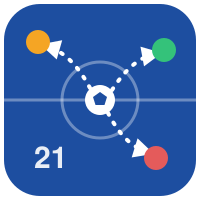

<p align="center">
  
</p>

# pirlo

Faz o agente que você usa (o **líder**) passar o trabalho braçal para **workers mais baratos**, sem você chamar nenhum comando, e troca sozinho de IA quando uma fica sem cota. O líder continua pensando: planeja, decide e escreve o código que importa. O worker roda testes, lê logs longos, documentação e PDFs e faz buscas amplas, e devolve só um resumo curto com referências `arquivo:linha`.

O nome é uma homenagem ao Andrea Pirlo, que controlava o meio-campo: recebia a bola, decidia e distribuía.

Funciona no Linux, no WSL e no macOS, com qualquer IA de terminal como líder: Claude Code e Codex têm plugin, e as outras usam uma skill ou um bloco no `AGENTS.md`. Um comando instala, e um setup no terminal faz as perguntas.

## Por que isso economiza

A maior parte da cota não vai para o raciocínio do líder. Vai para o que ele **lê**: 30 mil tokens de log de teste para achar duas falhas, um PDF inteiro para achar um parágrafo. No pirlo, quem lê é um worker mais barato, num contexto separado, e o líder recebe só o resumo. É a mesma ideia do cookbook "plan big, execute small" da Anthropic: a economia vem de *quem lê*.

## Como funciona

```text
você ──► líder (Claude Code, Codex, Antigravity, Kimi...)
           │  tarefa braçal? delega sozinho
           ▼
   ┌─ comando:  bin/rails test 2>&1 | pirlo digest
   │            (o líder roda o comando, com as permissões dele)
   └─ leitura:  pirlo ask "o que a referência X diz sobre Y?"
           │
           ▼
         pirlo: saída curta? devolve direto, sem worker
           │
           ▼
         worker: CLI oficial em modo só leitura
         (agy com Gemini Flash, codex com modelo barato, claude com Haiku...)
           │
           ▼
         resumo curto com arquivo:linha ──► líder
         + uma linha no log local (usage.jsonl)
```

| Comando | Para quê |
| --- | --- |
| `<comando> 2>&1 \| pirlo digest` | testes, build, lint, LaTeX: o worker lê a saída e devolve as falhas |
| `pirlo ask "<tarefa>"` | ler arquivos, docs, PDFs, buscar no código, em modo só leitura |
| `pirlo edit "<tarefa>"` | edição mecânica pedida explicitamente (renomear, formatar, repetir um padrão) |

### Por que o líder roda o comando e o pirlo só lê a saída

Pelas permissões. Quem roda `bin/rails test` é o próprio líder, então valem as regras que você já tem na sessão. Se o Claude Code já pode rodar seus testes sem perguntar, o `bin/rails test 2>&1 | pirlo digest` também roda sem perguntar. Isso funciona porque o Claude Code checa cada lado do pipe separadamente: o `bin/rails test` contra as suas regras, e o `pirlo digest` contra a regra do pirlo.

Isso também é mais seguro: o pirlo nunca roda comandos do projeto, então liberar o pirlo não libera nenhum comando novo.

Há um segundo motivo. Em modo só leitura, os workers não conseguem rodar comandos: o `agy --mode plan` para e espera aprovação humana, e o sandbox `read-only` do Codex impede os testes de gravar cache e arquivos temporários. Por isso o comando roda fora do worker.

Se a saída for curta (até 2.500 caracteres), o pirlo nem chama o worker e devolve a saída direto. A saída completa fica guardada em `.pirlo/runs/`, para o líder abrir uma linha específica se precisar.

## Instalação

Precisa de Python 3.9 ou mais novo (o pirlo só usa a biblioteca padrão) e roda no Linux, no WSL e no macOS. Na pasta do projeto, rode:

```bash
curl -fsSL https://raw.githubusercontent.com/isaiasaltoe/pirlo/main/install.sh | sh
```

O comando põe o `pirlo` em `~/.local/bin` e abre o setup no terminal. O setup começa perguntando o idioma (português ou inglês) e explica cada pergunta antes de você responder:

1. **Líderes:** em quais IAs você quer usar o pirlo. Antes, ele procura todas as IAs de terminal instaladas: Claude Code, Codex, Antigravity, Gemini CLI, Kimi, Copilot CLI, opencode, Cursor CLI, Amp, Kiro, Qwen Code, Crush, Goose e Factory Droid. Das que também podem ser worker (`claude`, `codex` e `agy`), ele vê se estão logadas e lista os modelos. Essa detecção **não gasta cota**: usa `claude auth status`, `codex login status`, `codex debug models` (o catálogo local) e `agy models`;
2. **Escopo:** global (todos os repositórios) ou local (só o repositório em que você está). A configuração local fica em `.pirlo/`, fora do git;
3. **Workers, em ordem:** o setup propõe uma fila com uma IA de cada marca que você tem, as de marcas diferentes da do líder primeiro. Você pode reordenar, tirar alguma ou trocar o modelo de cada uma (veja [Quando uma IA fica sem cota](#quando-uma-ia-fica-sem-cota));
4. **Permissões do Claude Code:** se pode liberar os comandos de leitura do pirlo sem pedir aprovação (veja [Permissões](#permissões));
5. **Regra do Codex:** se pode gravar a regra que deixa o pirlo sair do sandbox do Codex (veja [Codex e o sandbox](#codex-e-o-sandbox)).

No fim, o setup mostra um resumo e só aplica se você confirmar. Ao aplicar, ele faz a instalação em cada IA:

| Líder | O que o setup faz |
| --- | --- |
| Claude Code | `claude plugin install pirlo --marketplace isaiasaltoe/pirlo --scope user` ou `--scope local`, conforme o escopo |
| Codex | `codex plugin marketplace add isaiasaltoe/pirlo`, `codex plugin add pirlo@pirlo` e, se você aceitar, a regra do sandbox |
| Outra IA, escopo local | adiciona as instruções do pirlo ao arquivo que ela lê (`AGENTS.md`, ou `GEMINI.md` no Gemini CLI e `QWEN.md` no Qwen Code) e deixa o arquivo fora dos seus commits |
| Outra IA, escopo global | instala as skills (`SKILL.md`) na pasta que você indicar, para CLIs que leem skills |

Para mudar alguma resposta depois, rode `pirlo setup` de novo. Para atualizar o pirlo, rode o comando de instalação de novo. No Claude Code também existe o `/pirlo:setup`, que faz as mesmas perguntas dentro da sessão.

**Por que o escopo é uma pergunta do setup, e não uma opção do comando de instalação?** O comando de instalação é o mesmo para todo mundo. Quem decide onde o pirlo fica ativo é você, respondendo no terminal, e o setup traduz a resposta para o formato de cada IA. O Claude Code tem escopo de plugin. O Codex não tem, então o pirlo fica desligado nos repositórios sem configuração local.

**Por que uma fila por marca, e não níveis de modelo?** O que se delega já é, por definição, trabalho de pouca decisão: planejamento, arquitetura, design e decisões ficam sempre com o líder. O que faz diferença é ter para onde ir quando uma assinatura acaba, e cada marca é uma assinatura com cota própria.

### Filas propostas

| Você tem | Líder | Fila de workers proposta |
| --- | --- | --- |
| Claude + Google AI Pro + ChatGPT | Claude Code | `agy` (Gemini Flash) → `codex` (modelo menor) → `native` |
| Claude + Google AI Pro | Claude Code | `agy` (Gemini Flash) → `native` |
| Só Claude | Claude Code | `native`: o próprio subagente `pirlo:worker`, em Haiku |
| Só Codex | Codex | `codex exec` com o modelo menor, em sandbox `read-only` |
| Google AI Pro + ChatGPT | Antigravity | `codex` (modelo menor) → `agy` (Gemini Flash) |

Os IDs dos modelos nunca ficam fixos no código: vêm do que cada CLI lista na sua máquina.

## Quando uma IA fica sem cota

O pirlo cuida disso sozinho, a cada delegação. Ele percorre a fila de workers na ordem que você escolheu, com três ajustes:

1. **A marca do líder vai para o fim.** Se você está no Claude Code, um worker Claude gastaria a mesma cota do líder, então o pirlo prefere as outras marcas. Ele reconhece quando o líder é o Claude Code ou o Codex pelas variáveis de ambiente que eles exportam. Nos outros líderes, defina `PIRLO_LEAD=<nome>` se quiser o mesmo efeito.
2. **Quem está com pouca cota vai para o fim.** Acima de 90% de uma janela de cota (`switchAt`), a marca passa para trás das outras. O pirlo sabe a cota:
   - do **Claude**, pelo evento de cota que o `claude -p` imprime a cada chamada;
   - do **Codex**, pelos arquivos de sessão que o próprio Codex grava em `~/.codex/sessions`;
   - do **Antigravity**, não sabe: o `agy` não informa a cota, então vale o item 3.
3. **Quem falha por cota descansa.** Se um worker responde com erro de cota (limite atingido, 429, `RESOURCE_EXHAUSTED`...), o pirlo passa a mesma tarefa para o próximo da fila, **na mesma chamada**, e deixa aquela marca de fora até o reset da cota. Quando o horário do reset é desconhecido, ele espera `cooldownMinutes` (60 por padrão).

O rodapé da resposta conta o que aconteceu, por exemplo `[pirlo: codex gpt-6-luna medium, 9.2s; agy gemini-3.8-flash-medium out of quota (resting until 15:30)]`. Se todas as marcas estiverem sem cota, o líder faz o trabalho sozinho; no Claude Code, o subagente em Haiku assume. Para ver a fila e as cotas a qualquer momento, rode `pirlo show`.

O **líder**, o pirlo não troca: é o programa em que você está digitando, e cada IA guarda a sua própria conversa.

## Uso

Você não faz nada: escreve normalmente.

- "roda os testes e me diz o que quebrou": o líder roda os testes com `| pirlo digest`, e o worker devolve só as falhas com `arquivo:linha`;
- "o que o capítulo 3 da referência X diz sobre Y?": o worker lê o PDF e responde em poucas linhas;
- "o LaTeX deu erro, o que foi?": o líder compila, e o worker lê o log e aponta a linha.

Para tarefas independentes, o líder pode chamar vários workers em paralelo.

**Como o líder sabe que deve delegar?**

- **No Claude Code**, por dois caminhos. O primeiro é a descrição do subagente `pirlo:worker`, que o Claude Code usa para decidir quando delegar. O segundo é um lembrete curto (~110 tokens) que um hook coloca **uma vez no início da sessão**, só nos repositórios em que o pirlo está ativo. O lembrete existe porque, nos testes, só a descrição nem sempre bastou: com "rode os testes", o líder às vezes preferia fazer sozinho. Com o lembrete, ele delegou.
- **No Codex**, pela skill `pirlo`, que o Codex invoca sozinho quando a tarefa bate com a descrição. O Codex não delega para subagentes sem que você peça, por isso o pirlo usa uma skill nele.
- **Nos outros líderes**, pela skill ou pelo bloco no `AGENTS.md`.

## Só leitura por padrão

O worker roda em modo só leitura: `agy --mode plan`, `codex exec --sandbox read-only`, `claude -p --permission-mode plan`. Edição só acontece com `pirlo edit`, quando o pedido é explicitamente mecânico.

O motivo é o custo escondido do retrabalho: se o worker edita mal, o líder precisa reler tudo, e a economia some.

Depois de cada chamada, o pirlo compara o `git status` de antes e de depois:

- em modo só leitura, se algum arquivo mudou, a resposta traz um **aviso** com a lista dos arquivos;
- em modo de edição, a resposta lista os arquivos alterados, para o líder conferir só o `git diff` deles.

## Compatível com o fessor

Quando o [fessor](https://github.com/isaiasaltoe/fessor) está ativo no projeto, o pirlo:

- força o modo só leitura (um `pirlo edit` vira leitura e avisa o líder);
- avisa o worker que o usuário é estudante: ele nunca resolve exercícios nem dá a correção de erros, só relata fatos (o que os arquivos contêm, o que o comando imprimiu, onde as coisas estão).

O pirlo considera o fessor ativo quando encontra `"fessor@...": true` em `enabledPlugins` de `.claude/settings.local.json`, `.claude/settings.json` ou `~/.claude/settings.json`, ou uma seção `# fessor` no `AGENTS.md` ou no `GEMINI.md`.

Para respeitar outros plugins pedagógicos ou restritivos, adicione o nome deles em `restrictivePlugins` na configuração. Para forçar o modo só leitura em qualquer lugar, defina `PIRLO_READ_ONLY=1`.

## Permissões

O setup pergunta sobre as duas coisas abaixo e explica cada uma. Esta seção é a versão longa.

### Claude Code

O Claude Code pede aprovação antes de rodar comandos. Se você aceitar no setup, ele adiciona em `~/.claude/settings.json`:

```json
{
  "permissions": {
    "allow": [
      "Bash(pirlo ask *)",
      "Bash(pirlo digest*)",
      "Bash(pirlo savings*)",
      "Bash(pirlo detect*)",
      "Bash(pirlo show*)"
    ]
  }
}
```

Esses comandos só leem e pedem um resumo ao worker, então liberar é seguro. O comando que vem antes do pipe (`bin/rails test`, `npm test`...) continua seguindo as suas regras de sempre. O `pirlo edit` continua pedindo aprovação, porque altera arquivos. Para fazer isso sem o setup, rode `pirlo allow`.

### Codex e o sandbox

No Codex, todo comando roda num sandbox que, por padrão, **bloqueia a internet**. O pirlo precisa de internet: ele chama outro CLI (`agy`, `codex`...), que conversa com os servidores do Google, da OpenAI ou da Anthropic. Dentro do sandbox essa chamada falha, e o Codex pede para rodar o comando fora dele. Sem nada configurado, isso aconteceria a cada delegação.

O Codex resolve isso com **regras** (arquivos `.rules`): um comando que casa com uma regra `allow` roda fora do sandbox sem perguntar. Se você aceitar no setup, ele grava `~/.codex/rules/pirlo.rules`, que libera só os comandos de leitura do pirlo:

```python
prefix_rule(pattern = ["pirlo", ["ask", "digest", "savings", "detect", "show"]], decision = "allow")
```

Os comandos do seu projeto continuam no sandbox. Para conferir a regra:

```bash
codex execpolicy check --rules ~/.codex/rules/pirlo.rules pirlo digest
```

O resultado deve ser `"decision":"allow"`.

Dois limites, segundo as instruções do próprio Codex:

- o Codex avalia cada lado do pipe separadamente, mas **não compara com as regras** comandos com redirecionamento (`>`, `<`). O `2>&1` de `npm test 2>&1 | pirlo digest` pode cair nesse caso e voltar a pedir aprovação;
- a regra só casa quando o comando começa com `pirlo`, por isso o `pirlo` precisa estar no PATH (o comando de instalação cuida disso).

Isso não foi testado com uma conta logada. Se o Codex continuar pedindo aprovação, aprove com a opção de lembrar a regra.

## Quanto economizou

No Claude Code, rode `/pirlo:savings`. Nos outros líderes, pergunte pela economia do pirlo. No terminal, rode `pirlo savings`, com `--days 7` para outro período ou `--here` para só o repositório atual.

Cada delegação grava uma linha em `~/.config/pirlo/usage.jsonl` com: data, repositório, CLI, modelo, duração, tamanho do prompt, tamanho da resposta, uso de tokens reportado pelo CLI e sucesso ou falha. O pirlo grava essa linha sozinho, então o log não custa tokens.

O relatório é uma **estimativa**, e diz isso na saída. Não dá para medir quanto o líder teria lido sem o pirlo. Por isso ele mostra uma faixa:

- **piso:** a saída de comandos que o líder nunca viu, menos o que voltou para ele. Esse número é sólido, porque sem o pirlo o líder teria lido aquela saída inteira;
- **teto:** o piso mais o que os workers leram nas tarefas `ask`. Os números de tokens vêm do próprio CLI quando ele reporta (`--output-format json` no `agy` e no `claude`, `--json` no `codex`) e, quando não reporta, de uma estimativa por caracteres. É um teto porque inclui o system prompt do próprio worker.

O relatório também mostra o lado do líder: o texto que ele escreveu para delegar e as respostas que leu. O subagente intermediário do Claude Code (Haiku) **não entra na conta**, porque o pirlo não tem como medir os tokens dele.

## Custos que o pirlo tem

Para você decidir com números:

| O quê | Custo | Quando |
| --- | --- | --- |
| Descrições do subagente e das skills | ~260 tokens | em toda sessão do Claude Code |
| Lembrete do hook | ~110 tokens | uma vez por sessão, só onde o pirlo está ativo |
| Subagente `pirlo:worker` (Haiku) | ~550 tokens de instruções, mais o contexto base do subagente | a cada delegação no Claude Code |
| `claude -p` como worker | ~34 mil tokens de contexto fixo, quase todo em cache | a cada chamada, se o worker for o `claude` |

Por isso, para quem só tem Claude, o padrão é `native`: o subagente em Haiku sai bem mais barato que chamar `claude -p`.

A delegação compensa quando há muito para ler: logs grandes, documentação, PDFs, buscas amplas. Não compensa em design de landing page nem em edições pequenas e pontuais. A descrição do subagente diz isso ao líder.

## Configuração

O arquivo fica em `~/.config/pirlo/config.json` (escopo user) ou em `.pirlo/config.json` (escopo local, com prioridade). O setup escreve esse arquivo, mas dá para editar à mão:

```json
{
  "version": 3,
  "scope": "user",
  "workers": [
    { "cli": "agy", "model": "gemini-3.8-flash-medium" },
    { "cli": "codex", "model": "gpt-6-luna", "effort": "medium" },
    { "cli": "native" }
  ],
  "switchAt": 90,
  "maxReplyWords": 200,
  "inlineOutputChars": 2500,
  "restrictivePlugins": ["fessor"]
}
```

| Campo | O que faz | Padrão |
| --- | --- | --- |
| `workers` | a fila de workers, em ordem. Cada um tem CLI, modelo e esforço (`effort`). `cli` pode ser `agy`, `codex`, `claude`, `native` (só no Claude Code) ou um adaptador | — |
| `switchAt` | porcentagem de uma janela de cota a partir da qual a marca vai para o fim da fila | 90 |
| `cooldownMinutes` | quanto tempo uma marca que falhou por cota descansa, quando o horário do reset é desconhecido | 60 |
| `maxReplyWords` | tamanho de resposta pedido ao worker | 200 |
| `maxReplyChars` | corte duro da resposta, para proteger o contexto do líder | 6000 |
| `inlineOutputChars` | até esse tamanho, a saída do comando volta direto ao líder, sem worker | 2500 |
| `embedOutputChars` | até esse tamanho, a saída vai dentro do prompt do worker; acima, vai num arquivo que ele lê | 50000 |
| `workerTimeoutSeconds` | limite de tempo do worker | 600 |
| `restrictivePlugins` | plugins que forçam o modo só leitura | `["fessor"]` |
| `log` | grava o log de uso | `true` |
| `paths` | caminho de um CLI fora do PATH, como `{"agy": "/opt/agy/bin/agy"}` | — |
| `adapters` | outros CLIs como worker (veja abaixo) | — |

### Outros CLIs como worker

Qualquer CLI com modo não interativo pode ser o worker:

```json
{
  "adapters": {
    "meu-cli": {
      "command": ["meu-cli", "--model", "{model}", "--print", "{prompt}"],
      "format": "text"
    }
  },
  "workers": [{ "cli": "meu-cli", "model": "modelo-barato" }]
}
```

Confira as flags no `--help` do CLI antes. `{prompt}`, `{cwd}` e `{model}` são substituídos sem passar por shell, e sem `{prompt}` a tarefa vai pelo stdin. `format` pode ser `text`, `json` (um objeto) ou `jsonl` (um evento por linha). Um adaptador só edita se tiver `editCommand`. Num adaptador, o modo só leitura depende só das instruções dadas ao worker, por isso a checagem do `git status` é ainda mais importante nele.

## Termos de serviço

Cada worker é o **CLI oficial**, logado na sua própria assinatura e chamado em modo não interativo. O pirlo nunca lê, extrai ou repassa tokens de login, e não usa proxies de assinatura (9Router, CLIProxyAPI, OpenCode com OAuth de assinatura e similares).

O motivo: a Anthropic bloqueia tokens OAuth do Claude Free/Pro/Max fora do Claude Code e do claude.ai, e o Google baniu contas que usaram o OAuth do Gemini/Antigravity em ferramentas de terceiros.

## O que ainda não foi testado de verdade

A primeira versão foi feita numa máquina sem o `agy` e sem as contas do autor. Por isso:

- o `agy` foi testado só com um CLI falso que imita a saída descrita no `agy --help`. O formato exato do `--output-format json` e da lista do `agy models` precisa ser confirmado na máquina real. Se não bater, o pirlo ainda devolve o texto, mas pode não ler o uso de tokens;
- o `codex exec` e a regra do Codex foram conferidos no `codex` 0.164, mas nunca rodaram com uma conta logada. A leitura da cota do Codex segue o formato que ele grava nos arquivos de sessão, testada só com um arquivo de exemplo. Os workers Codex agora deixam a sessão gravada (sem `--ephemeral`), justamente para essa leitura ficar atualizada, então eles aparecem no histórico do `codex resume`;
- a troca de worker por cota foi testada com CLIs falsos. A leitura da cota do Claude foi conferida com o `claude` real;
- o `claude -p` como worker, a delegação automática no Claude Code e o pipe usando as permissões da sessão foram testados de verdade;
- o setup foi testado de verdade num terminal, instalando o plugin no `claude` e no `codex` reais, mas com o marketplace apontando para uma cópia local. A instalação a partir do GitHub (`curl ... | sh` e `--marketplace isaiasaltoe/pirlo`) só funciona com o repositório público.

Para conferir na sua máquina:

```bash
pirlo detect                                  # CLIs, login e modelos
pirlo show                                    # fila de workers, cotas e quem está descansando
pirlo ask "o que tem em README.md?"
seq 1 2000 | pirlo digest --task "qual é o último número?"
pirlo savings
```

## Desenvolvimento

```bash
python3 -m unittest discover -s tests -v
claude plugin validate .
```

Os testes usam CLIs falsos em `tests/stubs/`, que imitam a saída do `agy`, do `codex` e do `claude`. O CI roda no Linux e no macOS.

## Licença

MIT
